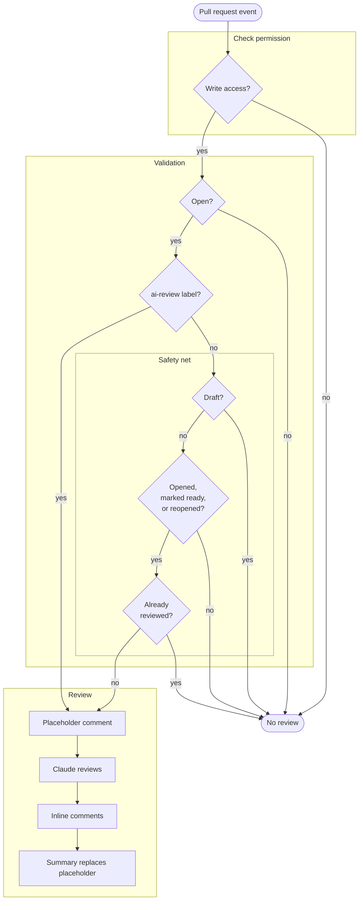

# Claude review code

## Summary

Runs an automated Claude Code review on pull requests. Reviews fire automatically when a PR is opened, converted from draft, or reopened (safety net), and can be triggered on demand by adding the `ai-review` label.

## When to use it

The review runs once on its own when a pull request is opened, marked ready for review, or reopened. Drafts are skipped.

Add the `ai-review` label to review a draft or to get another pass. Remove the label afterward. While it is on, the review reruns on every push and each time another label is added.

## How it works

The workflow runs three jobs in order. Each job runs only if the one before it passes.

1. **Check permission** confirms that the user who triggered the run has write permission on the repository. It uses [`check-permission`](../check-permission/README.md).
2. **Validation** decides whether a review runs and which variant. It uses [`check-review-gate`](../check-review-gate/README.md).
3. **Review** runs the review and posts the findings on the pull request. It uses [`run-code-review`](../run-code-review/README.md).

<details>
<summary>Workflow diagram</summary>



> _Perspective: For engineers who open pull requests or maintain this workflow, showing the rules that decide whether a pull request event leads to a Claude review and what the review posts. Grouped by the job that applies each rule. Omits the steps inside each job, and treats `ai-review-vnext` the same as `ai-review`._

</details>

## Usage

See [`review-code.yml`](./review-code.yml) for a calling workflow template.

The calling workflow must pass the following secrets:

```yaml
jobs:
  review:
    uses: bitwarden/gh-actions/.github/workflows/_review-code.yml@main
    secrets:
      AZURE_SUBSCRIPTION_ID: ${{ secrets.AZURE_SUBSCRIPTION_ID }}
      AZURE_TENANT_ID: ${{ secrets.AZURE_TENANT_ID }}
      AZURE_CLIENT_ID: ${{ secrets.AZURE_CLIENT_ID }}
    permissions:
      actions: read
      contents: read
      pull-requests: write
      id-token: write
```

## Inputs

Secrets:

- `AZURE_SUBSCRIPTION_ID`
- `AZURE_TENANT_ID`
- `AZURE_CLIENT_ID`

## Outputs

None

## Requirements

- The calling repository must have access to the `gh-org-bitwarden` Azure Key Vault, which contains the `ANTHROPIC-CODE-REVIEW-API-KEY` secret used to authenticate with the Anthropic API.
- Only users with **write** permission on the repository can trigger a review. Requests from users without write access are silently skipped.
- The `ai-review` and `ai-review-vnext` labels must exist in the calling repository.

### GitHub Permissions

The calling workflow must grant the following GitHub permissions to the `_review-code.yml` action:

| Permission      | Access  | Reason                                                               |
| --------------- | ------- | -------------------------------------------------------------------- |
| `actions`       | `read`  | Read workflow run status for progress tracking                       |
| `contents`      | `read`  | Check out repo to read code for review                               |
| `id-token`      | `write` | Authenticate with Azure and get the Claude GitHub App token via OIDC |
| `pull-requests` | `write` | Post and update comments on pull requests                            |

## Features

- **Safety net**: Runs automatically when a PR is opened, converted from draft, or reopened — no label required. Skips if a review comment already exists (idempotency guard).
- **On-demand label triggers**: Adding `ai-review` runs the current review variant; `ai-review-vnext` runs the next-generation variant. `ai-review-vnext` is only for beta testers of review changes, and only when the AI Team asks. Label triggers bypass draft status and the idempotency guard, but not the state check.
- **Open PRs only**: Closed and merged PRs are never reviewed, regardless of labels. This covers labeling a closed PR and pushing to the head branch of one.
- Uses a sticky comment — Claude updates a single comment rather than posting new ones
- Loads `plugin-dev` from [Anthropic's plugin marketplace](https://github.com/anthropics/claude-plugins-official), and `bitwarden-code-review`, `bitwarden-software-engineer`, `bitwarden-security-engineer`, and `claude-config-validator` from the [Bitwarden marketplace](https://github.com/bitwarden/ai-plugins)
- Claude's tool access includes file reading (`Read`, `Grep`, `Glob`), git history (`git diff`, `git log`, `git show`), and PR interaction (`gh pr view/diff/checks`, inline comments)

## Special Considerations

- Claude runs with the **Opus** model
- The Claude step has a **10-minute timeout**; the overall review job has a **15-minute timeout**

## Troubleshooting

| Symptom                                  | Likely cause                                                                                                                              |
| ---------------------------------------- | ----------------------------------------------------------------------------------------------------------------------------------------- |
| No review when PR is opened              | The calling workflow does not trigger on `opened`, `ready_for_review`, and `reopened` events — copy the latest `review-code.yml` template |
| No review after adding `ai-review` label | Actor lacks write permission, or the calling workflow does not trigger on `labeled` events                                                |
| Safety net ran but review was skipped    | A sticky comment with the review marker already exists from a prior run (idempotency guard)                                               |
| Review skipped on a draft PR             | Expected — the safety net does not run on drafts. Add the `ai-review` label to force a review on a draft.                                 |
| No review after labeling a closed PR     | Expected — closed and merged PRs are never reviewed. Reopen the PR first.                                                                 |
| Workflow fails at secret retrieval       | Azure credentials are missing or the calling workflow did not pass the required secrets                                                   |
| Claude response stops mid-way            | 10-minute step timeout was hit; consider breaking the request into smaller tasks                                                          |
